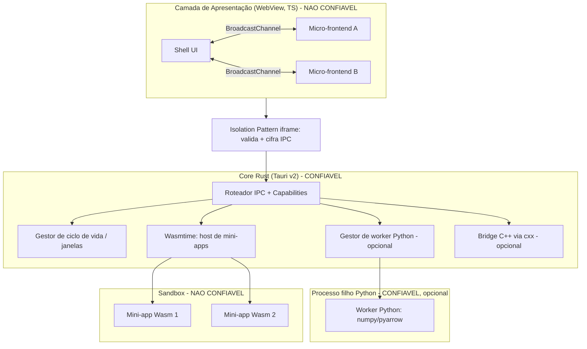

# 01 · Visão Geral da Arquitetura

Resumo da arquitetura proposta em [investigation-v1.md](../investigation-v1.md), com fronteiras de confiança e ressalvas explícitas.

## Camadas

## Fronteiras de confiança

| Fronteira | De → Para | Controle |
|---|---|---|
| F1 | WebView → Core | Capabilities estáticas + Isolation Pattern + CSP; payload validado |
| F2 | Mini-app Wasm → Core | Imports WIT explícitos, fuel metering, limite de memória, sem I/O por padrão |
| F3 | Core → Python | Código do host (confiável); isolado em **processo filho** gerenciado pelo Rust (ADR-003, S1); **não** executa código de terceiros |
| F4 | Core → C++ | `cxx` com tradução de exceções; módulo do host (confiável) |

Regra: **código de terceiros só roda em Wasm**. Python/C++ são do host.

## Fluxos de dados

| Fluxo | Mecanismo | Quando |
|---|---|---|
| UI ↔ UI (mesmo domínio) | `BroadcastChannel` | Sincronização visual/estado leve |
| UI ↔ Core (controle) | Comandos Tauri (JSON) | Mensagens pequenas |
| UI ↔ Core (dados grandes) | Binary IPC (`ArrayBuffer`) | Malhas 3D, resultados de queries, áudio |
| Core ↔ Python | Arrow IPC (pipe/memória compartilhada) com worker externo | Tabelas/tensores |
| Core ↔ C++ | `cxx` (+ `cxx-async` com Tokio) | Inferência/gráficos |
| Core ↔ Mini-app | WIT (Component Model) | API do host para plugins |

## Mapeamento investigação → componente

| Referência | Lição aplicada |
|---|---|
| WeChat (Dual-Thread) | Separar lógica de render; falhas de segurança de apps mal escritos → permissões declarativas impostas pelo host |
| Alipay (V8 Isolates) | Isolar contextos; evitar serialização JSON repetida → Binary IPC |
| VS Code (Extension Host, AHP) | Código de extensão fora do processo de UI; protocolo tipado; estado desacoplado da janela |
| Feishu/Lark | Permissões em nível de organização; integrações em segundo plano |
| FinClip | Container de mini-app + Native Bridge com checagem de permissão em tempo real |

## Ressalvas (hipóteses a validar nos spikes)

- ~~Multi-interpretador PyO3/PEP 684~~: **refutado em S1** (numpy/pyarrow não carregam em subinterpretadores); adotado worker externo.
- ~~Maturidade de WASI 0.3~~: **não usar por ora**; WASI 0.2 + async no host (S2). Reavaliar quando estabilizar.
- ~~Isolation Pattern × Binary IPC × múltiplas webviews~~: **ok no Windows** (S3, 4,4×); falta Linux/macOS.
- Latência do Arrow IPC com o worker Python: **ainda não medida** (início da Fase 3).
- Diferenças de WebView entre SOs (WebView2, WKWebView, WebKitGTK).

Ver [03-risks-and-spikes.md](03-risks-and-spikes.md) e ADRs em [04-adrs/](04-adrs/).
