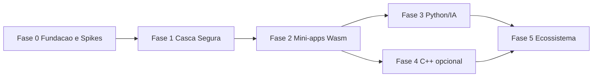

# 02 · Roadmap por Fases

Dimensionado para **dev solo + IA**. Estimativas em semanas de trabalho focado; são ordens de grandeza, revisadas a cada gate. Cada fase termina em um **gate** mensurável; sem gate verde, não se avança.

## Fase 0 · Fundação e Spikes (~2–3 sem)
- **Objetivo**: preparar o repo e remover as maiores incertezas.
- **Entregáveis**: monorepo ([08-repo-structure.md](08-repo-structure.md)); CI mínima nos 3 SOs; spikes S3, S5, S2, S1 (S4 se C++ continuar); ADRs atualizados.
- **Gate**: cada spike com decisão go/no-go registrada; ADR-003/004/005/006/007 em status *Accepted*.

## Fase 1 · Casca Segura — MVP do host (~4–6 sem)
- **Objetivo**: host Tauri v2 seguro, multi-janela, com IPC binário.
- **Entregáveis**: core Rust com roteador IPC; capabilities e escopos; Isolation Pattern; shell + 2 micro-frontends de exemplo; BroadcastChannel; Binary IPC; CSP; empacotamento instalável nos 3 SOs; benchmarks automatizados.
- **Gate**: cold start, RAM e tamanho medidos e dentro de tolerância das metas (ou metas revisadas com justificativa); E2E verde nos 3 SOs; comando IPC fora de escopo é bloqueado e logado.

## Fase 2 · Plataforma de Mini-Apps Wasm (~5–7 sem)
- **Objetivo**: executar código de terceiros com isolamento forte.
- **Entregáveis**: Wasmtime embutido; WIT da API do host (v0); fuel e limites de memória; formato de pacote + manifesto de permissões + assinatura; loader e ciclo de vida (instalar/executar/suspender/remover); SDK mínimo; 2 mini-apps de exemplo (Rust + outra linguagem); UI de consentimento de permissões.
- **Gate**: suíte de ataques (loop infinito, estouro de memória, acesso a FS/rede não declarado, manifesto adulterado) 100% contida; mini-app exemplo roda nos 3 SOs.

## Fase 3 · Camada Python/IA (~4–6 sem, conforme S1)
- **Objetivo**: capacidade analítica/IA no host.
- **Entregáveis**: Python como módulo opcional (download sob demanda); pool de interpretadores ou worker isolado (decidido em ADR-003); ponte Arrow zero-copy; uma feature real de IA/dados exposta à UI e ao WIT; gestão do ciclo de vida/erros (sem processos zumbi).
- **Gate**: ganho de paralelismo e latência medidos vs baseline sidecar; falha do Python não derruba o host.

## Fase 4 · Camada C++ nativa (~3–5 sem, sob demanda)
- **Objetivo**: acelerar um caso real (ex.: inferência llama.cpp ou gráficos).
- **Entregáveis**: bridge `cxx`/`cxx-async`; tradução de exceções→`Result`; um módulo real; build reproduzível.
- **Gate**: build verde nos 3 SOs; falha C++ recuperável sem abort. **Só executar se houver caso de uso concreto.**

## Fase 5 · Ecossistema e Endurecimento (~4–6 sem)
- **Entregáveis**: distribuição/registro de mini-apps (assinados); auto-update; telemetria opt-in; auditoria de segurança; docs de desenvolvedor; beta fechado.
- **Gate**: auditoria sem achados críticos abertos; update seguro verificado; beta com feedback incorporado.

## Estimativa total
~22–33 semanas com todas as fases; ~16–22 sem pulando Fase 4. Reavaliar após a Fase 0 (spikes podem cortar ou reordenar fases).

## Regras de governança
- Máximo 1 fase em progresso; WIP limitado.
- Mudança de arquitetura = novo ADR.
- Backlog detalhado em [05-backlog-epics.md](05-backlog-epics.md); riscos em [03-risks-and-spikes.md](03-risks-and-spikes.md).
